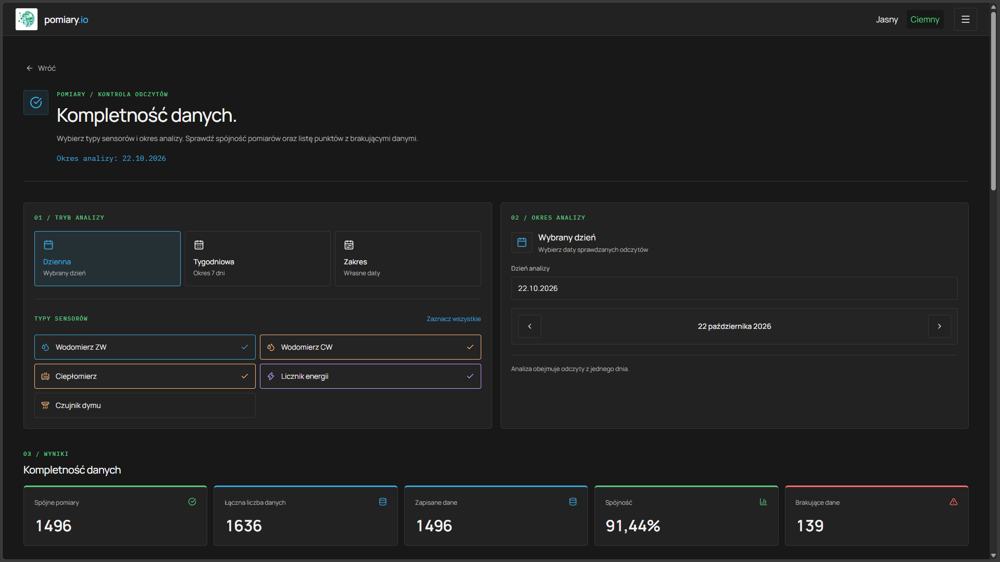

# Hi, I'm Maksymilian Leszczyński 👋

I'm a computer science student and a full-stack developer working in IoT. I'm the sole developer behind [pomiary.io](https://pomiary.io/), a platform for remotely collecting readings from meters and sensors.

I work across the stack, from integrating devices and decoding readings to building APIs and the web portal where users view their data. My favorite part is tracing a reading all the way from a physical device to the screen, especially when I have to figure out where it went missing.

## What I'm working on

- **pomiary.io** — A web platform for collecting and viewing meter and sensor readings.
- **Android app for field meter readings** — An app that helps field teams check which meters have been read and which readings are still missing.
- **IoT integrations** — Processing LoRaWAN and Wireless M-Bus data, and piloting remote gas meter readings over NB-IoT using DLMS.

## Technologies I work with

- **Backend** — Java, Spring Boot, PostgreSQL
- **Web** — TypeScript, React, Next.js, Tailwind CSS
- **Mobile** — Kotlin, Jetpack Compose
- **IoT and infrastructure** — LoRaWAN, Wireless M-Bus, ChirpStack, Docker

## Outside of coding

I read books, watch films and TV shows, listen to music and podcasts, play PC games, and talk to my parrot.

## Find me online

- [LinkedIn](https://www.linkedin.com/in/maksymilianleszczynski)
- [Portfolio](https://maksssl2020.github.io/My-Website-Portfolio/)

## pomiary.io in action

